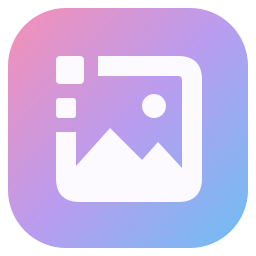
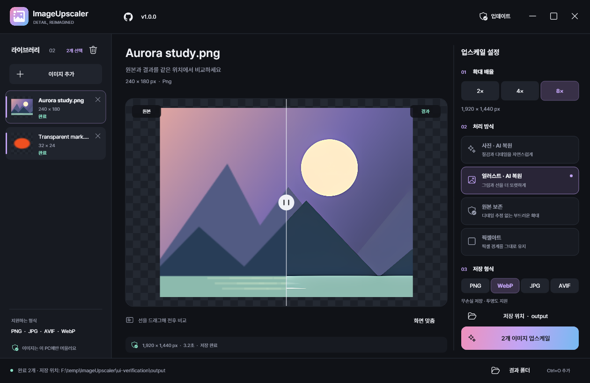

<h1 align="center"> ImageUpscaler</h1>

<p align="center">
  <a href="https://github.com/deuxdoom/ImageUpscaler/releases/latest"></a>
  <a href="https://github.com/deuxdoom/ImageUpscaler/releases" title="모든 릴리스의 ImageUpscaler.exe 다운로드 합계"></a>
  
  
  
</p>

<p align="center">
  
  
  
  
  
  
  
</p>

<p align="center"><strong>작은 이미지, 더 선명하게.</strong><br>사진·일러스트·투명 이미지·픽셀아트를 내 PC에서 최대 8배로 확대합니다.</p>

Windows 10/11 64비트용 프레임리스 이미지 업스케일러입니다. 단일 EXE에 모델·코덱·런타임을 포함합니다.
PNG · JPG · WebP · AVIF, 2× · 4× · 8×, 투명도 보존, 일괄 처리와 전후 비교를 지원합니다.
최신 버전은 `1.0.0`(2026-10-11)입니다. 아래 다운로드 버튼으로 최신 GitHub 릴리스의 `ImageUpscaler.exe`를 바로 받을 수 있습니다.
이 저장소는 배포 안내용이며 앱 소스는 공개하지 않습니다. 실행 파일은 [GitHub 릴리스](https://github.com/deuxdoom/ImageUpscaler/releases)로 배포합니다.



<p align="center">
  <a href="https://github.com/deuxdoom/ImageUpscaler/releases/latest/download/ImageUpscaler.exe"></a>
  <a href="https://deuxdoom.github.io/ImageUpscaler/"></a>
  <a href="https://github.com/deuxdoom/ImageUpscaler/blob/main/CHANGELOG.md"></a>
</p>

<p align="center">
  <a href="#시작하기"></a>
  <a href="#이미지에-맞는-처리-방식"></a>
  <a href="#시스템-요구-사항"></a>
  <a href="#주의-사항-ai-모드와-그래픽카드"></a>
  <a href="#포터블-경로"></a>
  <br>
  <a href="#업데이트"></a>
  <a href="#받은-파일-확인"></a>
  <a href="#이미지-처리-범위"></a>
  <a href="#문서"></a>
</p>

## 시작하기

1. 원하는 폴더에 `ImageUpscaler.exe`를 두고 실행합니다.
2. 이미지를 끌어놓고 배율·처리 방식·저장 형식을 고릅니다.
3. 업스케일을 시작하고 비교선을 움직여 결과를 확인합니다.

EXE는 어느 드라이브에 두어도 실행됩니다. 이미지를 추가하거나 끌어 놓고 배율·처리 방식·저장 형식을 선택합니다.
기본 결과 폴더는 EXE 옆 `output`, 다른 폴더도 선택 가능합니다. 원본과 기존 결과를 덮어쓰지 않습니다.
목록 카드의 `X`를 누르면 그 이미지만 목록에서 뺍니다. `Ctrl`+클릭·`Shift`+클릭·`Ctrl+A`로 여러 장을 선택한 뒤
상단 휴지통이나 `Delete`를 누르면 선택한 이미지만 뺍니다. 디스크의 원본·결과 파일은 지우지 않습니다.
슬라이더로 전후 비교, 휠로 확대합니다. `Ctrl+O` 추가, `Tab` 버튼 이동, `←/→` 비교선,
`Esc` 취소, `F11` 최대화를 지원합니다. 버튼은 마우스로 누르는 동안만 강조되며, `Tab`으로 이동하면 키보드 포커스를 표시합니다.
최소화(`_`)하면 트레이로 내려가며 알림을 표시하고, 트레이 아이콘을 더블 클릭하면 복원합니다.
처음 실행하면 화면 가운데에서 열리고, 이후에는 마지막으로 닫은 위치·크기·최대화 상태로 열립니다.
연결이 끊긴 모니터에 있던 위치라면 다시 가운데에서 엽니다.
창의 `X`를 누르면 종료할지 먼저 확인합니다. 트레이 메뉴의 종료는 바로 끝냅니다.
같은 폴더의 프로그램은 한 번만 실행됩니다. 다시 실행하면 새 창 대신 열려 있는 창(트레이에 있어도)을 앞으로 가져옵니다.
상단 버전 배지를 누르면 GitHub 저장소를 엽니다. 트레이의 GitHub 옥토콘 메뉴에서도 바로 이동할 수 있습니다.

## 이미지에 맞는 처리 방식

| 모드 | 처리 | 출력 이름 예 |
|---|---|---|
| 사진 AI | Real-ESRGAN x4plus / Upscayl Standard와 동일 가중치 | `sample-photo-ai-4x.png` |
| 이미지 AI | x4plus-anime 6B / Upscayl Digital Art와 동일 가중치 | `sample-image-ai-4x.png` |
| 원본 보존 | 선형 색공간 Lanczos | `sample-faithful-4x.png` |
| 픽셀아트 | 정수 배율 Nearest neighbor | `sample-pixel-art-4x.png` |

중복 이름은 `sample-image-ai-4x-2.png`, `…-3.png`로 번호를 붙입니다.
AI 모드는 그래픽카드(Vulkan)를 사용합니다. 원본 보존과 픽셀아트는 그래픽카드 없이 동작합니다. 아래 [주의 사항](#주의-사항-ai-모드와-그래픽카드)을 먼저 확인하세요.
AI는 실제 4× 추론 후 2×는 축소하고, 8×는 2× 결과에 4× 처리를 한 번 더 적용합니다. 실패를 보간 결과로 대체하지 않습니다.
8×는 결과가 4,800만 픽셀 이하여야 하므로 약 75만 픽셀(예: 1000 × 750) 이하의 이미지에 사용할 수 있습니다.

## 시스템 요구 사항

- Windows 10/11 x64, EXE 옆에 `bin` 폴더를 생성할 수 있는 저장 위치.
- 사진 AI·이미지 AI: Vulkan을 지원하는 그래픽카드와 최신 그래픽 드라이버. 원본 보존·픽셀아트는 그래픽카드 없이 사용합니다.
- 이미지 처리는 로컬에서 이루어지며, 인터넷은 업데이트 확인·다운로드에 사용합니다.
- 언어: Windows 표시 언어가 한국어면 한국어로, 그 밖의 언어면 영어로 표시합니다.
  환경 변수 `IMAGEUPSCALER_LANG`을 `ko` 또는 `en`으로 지정하면 언어를 고정할 수 있습니다.

## 주의 사항: AI 모드와 그래픽카드

> [!IMPORTANT]
> **사진 AI·이미지 AI는 그래픽카드로 계산합니다.** 그래픽카드나 드라이버가 준비되지 않은 PC에서는 AI 모드가 동작하지 않습니다.
>
> 앱은 시작할 때 Vulkan을 쓸 수 있는지 자동으로 확인합니다. 쓸 수 없으면 두 AI 모드에 "그래픽카드(Vulkan)가 없어 사용할 수 없음"을
> 표시해 선택을 막고, 처리 방식을 **원본 보존**으로 바꿉니다. 드라이버를 설치한 뒤 다시 실행하면 원래 선택한 AI 모드로 돌아옵니다.

**Vulkan이란?** 그래픽카드로 계산을 처리하는 표준 기술입니다. 따로 설치하는 프로그램이 아니며, 그래픽카드 드라이버에 함께 들어 있습니다.

- **대부분의 PC는 그대로 사용할 수 있습니다.** NVIDIA GeForce GTX 600 시리즈 이후, AMD Radeon HD 7000 시리즈 이후,
  Intel 6세대 Core 이후의 내장 그래픽이라면 대체로 Vulkan을 지원합니다.
- **내 그래픽카드 확인:** `Ctrl+Shift+Esc`로 작업 관리자를 열고 **성능** 탭의 **GPU** 항목에서 이름을 확인합니다.
  GPU 항목이 없거나 이름이 "Microsoft 기본 디스플레이 어댑터"로 보이면 그래픽 드라이버가 설치되지 않은 상태입니다.
- **드라이버는 최신으로:** NVIDIA·AMD·Intel 공식 사이트에서 내 그래픽카드용 드라이버를 설치하거나 Windows 업데이트를 실행합니다.
- **동작하지 않을 수 있는 환경:** 원격 데스크톱으로 접속한 PC, 가상 머신, 아주 오래된 PC는 Vulkan을 쓰지 못할 수 있습니다.
- **처리 속도:** 내장 그래픽이나 오래된 그래픽카드는 처리 시간이 오래 걸릴 수 있습니다. 큰 이미지일수록 시간이 더 걸립니다.

AI 모드가 켜져 있는데도 "AI 처리에 실패했습니다. Vulkan GPU/드라이버를 확인하거나 원본 보존 모드를 선택해 주세요."라는 알림이 나오면
그래픽 드라이버를 업데이트한 뒤 다시 시도하세요. 그래도 안 되면 **원본 보존**이나 **픽셀아트** 모드를 사용하세요.
이 두 모드는 그래픽카드 없이 동작합니다. AI가 실패해도 다른 방식의 결과로 몰래 바꿔 저장하지 않습니다.

## 포터블 경로

```text
ImageUpscaler.exe
bin/
  settings.json       # 배율·모드·형식·결과 폴더·업데이트 옵션·창 위치
  temp/
    run-…/            # 런타임/모델 추출, 종료 후 삭제
    job-…/            # 이미지 중간 파일, 완료/취소 후 삭제
    update-…/         # 업데이트 임시/백업/helper, 성공 후 삭제
output/               # 기본 결과 폴더
```

`bin`은 **EXE 바로 옆**에 위치합니다. 런타임·모델·코덱·폰트·라이선스를 EXE에 포함합니다.
별도 설치/런타임 다운로드는 필요하지 않습니다. 실행기는 Windows 기본 .NET Framework 4.8을 사용합니다.
EXE가 있는 폴더에 `bin`을 만들 수 있어야 합니다. 설정은 종료할 때 저장하고 손상된 JSON은 기본값으로 복구합니다.

## 업데이트

[deuxdoom/ImageUpscaler](https://github.com/deuxdoom/ImageUpscaler)의 정식 릴리스를 시작 시 확인하고 유휴 상태에서 자동 설치합니다.
상단 버튼/트레이 메뉴로 직접 확인할 수도 있습니다. GitHub asset `sha256` digest를 우선 확인하고,
없으면 같은 릴리스의 `SHA256SUMS.txt`에서 `ImageUpscaler.exe`를 읽습니다. 검증값이 없거나 다르면 교체하지 않습니다.
다운로드 취소, 별도 helper 교체, 새 앱 시작 확인, 이전 EXE 삭제, **완료창 5초 자동 닫기**, 시작 실패 시 복구를 지원합니다.
`bin/settings.json`의 `CheckUpdates`/`AutoInstallUpdates`를 `false`로 지정하면 해당 자동 동작을 끕니다.
초안과 사전 릴리스는 업데이트 대상에서 제외하며, 정식 릴리스의 `ImageUpscaler.exe`만 내려받습니다.

## 받은 파일 확인

릴리스 노트에 적힌 SHA-256과 내려받은 EXE의 값을 비교하면 같은 파일인지 확인할 수 있습니다.

```powershell
Get-FileHash .\ImageUpscaler.exe -Algorithm SHA256
```

## 이미지 처리 범위

EXIF 방향 및 ICC→sRGB, PNG/WebP 무손실, AVIF 고품질 4:4:4, **8bit sRGB 출력**입니다.
HDR/16bit 정밀도 보존과 애니메이션/다중 페이지는 지원하지 않습니다. 투명 입력의 JPG 저장은 거부합니다.
alpha는 AI로 생성하지 않고 별도로 확대합니다. 48M 출력/내부 처리 픽셀 제한, 스테이징 검증,
큰 RGB 손상 감지, 취소 시 자식 프로세스/임시 파일 정리를 적용했습니다.
AI는 디테일을 추정하며, 손상 검사가 모든 지각적 품질 문제를 판별한다는 보장은 아닙니다.

## 문서

[알고리즘 안내](docs/algorithms.md) · [포터블/업데이트](docs/portable-updates.md) · [라이선스](docs/licenses.md) · [라이선스 전문](licenses)
